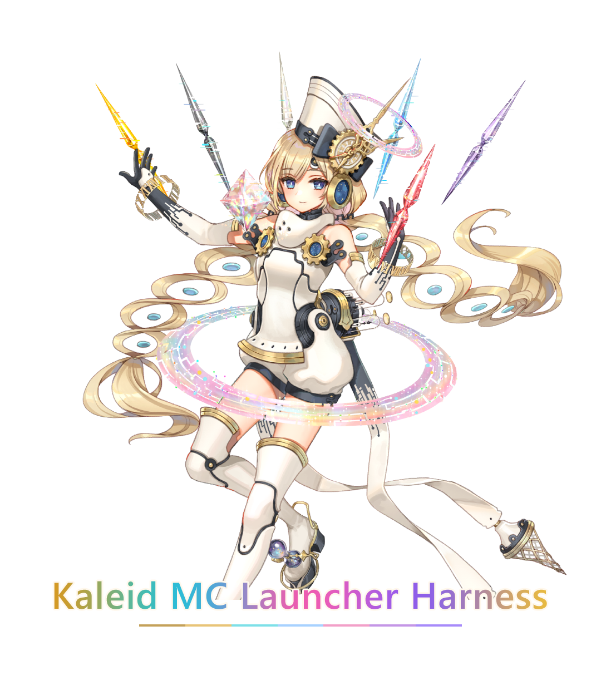

<p align="center">
  <a href="./README.md">中文</a> · <strong>English</strong>
</p>

<p align="center">
  
</p>

# Kaleid MC Launcher Harness

A Minecraft launcher where every capability is a plugin.

It does not replace a game directory you already have. A later plugin hangs another layer on the chain — another download source, for example — instead of having to displace the one before it. Illegal config, a broken version JSON, and a failed plugin apply are reported. Nothing silently resets your data.

## Run it

From the repository root:

```powershell
cargo test --workspace
cargo run -p kaleid-cli -- --help
dev.bat
```

`dev.bat` runs `tauri dev` inside `src-tauri`. That is the shell on the system WebView2. To look at the UI without the host:

```powershell
pnpm --dir ui dev
```

The data directory defaults to `%LOCALAPPDATA%\Kaleid`. Override it with `KALEID_DATA_DIR` or `kaleid --data-dir`. Accounts and per-version settings live there. Existing files in the game directory are left alone.

How to read the tests, and which cases need a real machine, is in [docs/testing.md](docs/testing.md).

## Map

| Path | Role |
|---|---|
| `crates/kaleid-kernel` | Service chain, reclaimable effects, events, patch composition |
| `crates/kaleid-api` | Service contracts and DTOs. The only shared language between kernel and plugins |
| `crates/kaleid-core-plugins` | Built-in plugins |
| `crates/kaleid-host` | Command table. The UI stops here |
| `crates/kaleid-cli` | Headless check: register, scan, print a launch command |
| `src-tauri` | Shell. Kept out of the workspace so core tests do not pull Tauri |
| `ui` | React 19, Vite 7, Tailwind v4. No component library |
| `presets` | Composition patches. Differences only |
| `plugins` | Example declarative manifests. Not part of the build |
| `docs/brand` | The mark. The README uses the transparent file; the white plate is `kaleid-mark-white.png` |

Manifest shape is in [plugins/README.md](plugins/README.md).

## License

[Apache License 2.0](LICENSE). Copyright and third-party components are in [NOTICE](NOTICE).

The name comes from Kaleid x Scope, a mode in SEGA's arcade rhythm game *maimai DX PRiSM* (maimai でらっくす PRiSM). The character(RIZ - PRISM) in the icon and the mark at the top is copyright SEGA. This project does not claim any rights to that artwork.

The Minecraft name and content belong to Mojang Studios / Microsoft. This project does not distribute the game.
